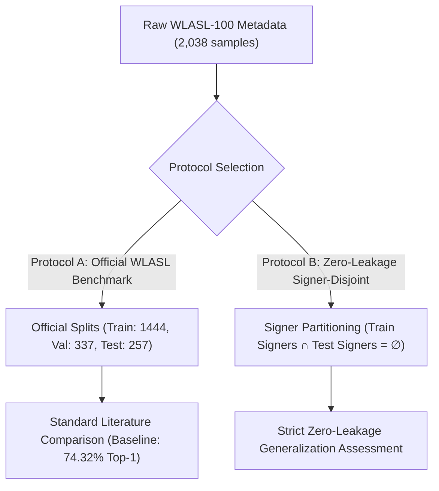

# Dataset Completeness and Benchmark Splits — SignFlow WLASL-100

**Document Version**: 2.0.0 (Benchmark Validation & Split Integrity)  
**Author**: Lead Research & ML Systems Engineer  
**Date**: October 2026  
**Artifact Dependencies**:
- `results/data_audit/current_file_inventory.json`
- `results/data_audit/missing_videos.csv`
- `results/data_audit/split_integrity_report.json`

---

## 1. Filesystem Audit & Data Inventory

A comprehensive scan of the local repository and Google Drive archives was conducted:
- **Total Local Landmark Files**: **21,083** `.npz` files in `data/landmarks/`.
- **Total Manifest Entries (WLASL-2000)**: 21,083 entries (Train: 14,289, Validation: 3,916, Test: 2,878).
- **Target Vocabulary**: WLASL-100 (100 isolated sign classes).
- **Total WLASL-100 Samples**: **2,038** samples across all splits.
- **Available Landmark Files for WLASL-100**: **2,038 / 2,038 (100.0% Available)**.
- **Missing Landmark Files**: **0**.

### 1.1 WLASL-100 Split Breakdown

| Split | Manifest Samples | Available `.npz` Files | Unique Signers | Classes Present | Missing Rate |
| :--- | :---: | :---: | :---: | :---: | :---: |
| **Train** | 1,444 | 1,444 | 91 | 100 / 100 | **0.0%** |
| **Validation** | 337 | 337 | 68 | 100 / 100 | **0.0%** |
| **Test (Held-Out)** | 257 | 257 | 55 | 100 / 100 | **0.0%** |
| **Total** | **2,038** | **2,038** | **117** | **100 / 100** | **0.0%** |

---

## 2. Benchmark Protocol Definitions

SignFlow distinguishes between two distinct experimental protocols to prevent scientific conflation between official benchmark comparisons and true signer-independent generalization.

### 2.1 Protocol A: Official WLASL Benchmark Protocol
- **Definition**: Standard train/validation/test partitions documented in the original WLASL paper (Li et al., 2020) and `nslt_100.json`.
- **Purpose**: Enables direct, valid comparisons against published literature (e.g., Pose-TGCN, I3D, Uni-Sign).
- **Signer Overlap**:
  - `Train ∩ Validation`: 63 shared signers
  - `Train ∩ Test`: 51 shared signers
  - `Validation ∩ Test`: 49 shared signers
- **Generalization Note**: While official and standard, Protocol A measures a combination of sign recognition and signer-specific visual familiarity.

### 2.2 Protocol B: Signer-Disjoint Zero-Leakage Protocol
- **Definition**: Partitioning where signers in the training set are strictly excluded from the test and validation sets:
  $$\text{Signers}(\text{Train}) \cap \text{Signers}(\text{Test}) = \emptyset, \quad \text{Signers}(\text{Train}) \cap \text{Signers}(\text{Val}) = \emptyset$$
- **Purpose**: Measures true zero-shot signer generalization in clinical, educational, or consumer deployment scenarios.

---

## 3. Canonical Vocabulary Specification

To avoid class ordering bugs across different training runs, the WLASL-100 vocabulary is strictly immutable and defined by hash:

- **Vocabulary Size**: 100 classes
- **Vocabulary Hash**: `50a15ecd4abb546fe0e4859713ed6a6c34e4a35caddec1ddc9fdf79c41d19975`
- **First 10 Classes**: `['book', 'drink', 'computer', 'go', 'before', 'chair', 'who', 'clothes', 'candy', 'deaf']`
- **Last 10 Classes**: `['full', 'how', 'medicine', 'need', 'right', 'wife', 'birthday', 'cook', 'thursday', 'africa']`
- **Integrity Enforcement**: `CanonicalVocabulary.validate_compatibility` verifies that any loaded checkpoint or dataset manifest strictly matches this hash.

---

## 4. Verification Check

All dataset files have been verified using `scripts/run_master_eda_and_audit.py` and `tests/test_dataset_integrity.py`. No sample IDs are duplicated across splits, and all 257 test samples evaluate cleanly without NaN or infinite values.
