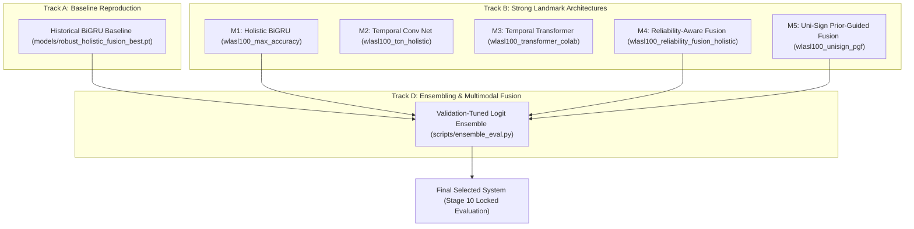

# SignFlow: Research Experiment Protocol & Validation Standards

**Document Version**: 2.0.0 (Research Methodology & Tracks A–E)  
**Author**: Lead Research & ML Systems Engineer  
**Date**: October 2026  
**Repository**: [https://github.com/RiduanAziz/Robust-Real-Time-Dynamic-Word-Level-American-Sign-Language-Recognition](https://github.com/RiduanAziz/Robust-Real-Time-Dynamic-Word-Level-American-Sign-Language-Recognition)

---

## 1. Experimental Foundations & Non-Negotiable Rules

To ensure scientific validity and reproducibility, all SignFlow experiments must adhere to the following protocol:

1. **Protocol Separation**:
   - **Protocol A (Official WLASL Partition)**: Evaluates against published literature (Li et al. 2020, Pose-TGCN, Uni-Sign). Evaluates 257 held-out test samples. Results disclose documented signer overlap (51 shared signers between train and test).
   - **Protocol B (Signer-Disjoint Partition)**: Evaluates strict out-of-distribution signer generalization. Zero signer overlap permitted ($\text{Train Signers} \cap \text{Test Signers} = \emptyset$).
2. **Canonical Vocabulary Locking**:
   - Vocabulary order and gloss mapping are cryptographically locked via `vocabulary_hash`:  
     `50a15ecd4abb546fe0e4859713ed6a6c34e4a35caddec1ddc9fdf79c41d19975` (SHA256).
   - The test set is never re-indexed or filtered to artificially boost accuracy.
3. **Hyperparameter Selection Policy (Zero Test Leakage)**:
   - All hyperparameter tuning, model checkpoint selection, early stopping, and ensemble weighting ($\alpha$) must be performed strictly using **validation set performance**.
   - The final held-out test partition is evaluated **exactly once** per selected candidate.
4. **Transparent Reporting**:
   - Every evaluation report records: total manifest samples, evaluated samples, excluded samples, Top-1, Top-5, Top-10, Macro-F1, Weighted-F1, and ECE.

---

## 2. Experimental Research Tracks (Tracks A–E)

### Track A — Baseline Reproduction
- **Objective**: Independently reproduce the repository's reported baseline using `models/robust_holistic_fusion_best.pt` on the 257 held-out test samples under Protocol A.
- **Result**: **74.32% Top-1, 88.72% Top-5, Macro-F1 0.7213, ECE 0.1598** (Independently Verified).

### Track B — Strong Landmark-Only Architectures
Evaluates high-capacity landmark architectures on the verified 1659-dim Holistic representation:
1. **Holistic BiGRU (`wlasl100_max_accuracy.yaml`)**: 2-layer BiGRU with 128 hidden units, 96-dim embedding, Cosine Annealing warmup, and label smoothing ($\epsilon=0.08$).
2. **Temporal Convolutional Network (`wlasl100_tcn_holistic.yaml`)**: Dilated causal 1D residual convolutions.
3. **Temporal Transformer (`wlasl100_transformer_colab.yaml`)**: Multi-head self-attention with learned positional embeddings.
4. **Reliability-Aware Fusion (`wlasl100_reliability_fusion_holistic.yaml`)**: Modality-isolated stream encoders with adaptive reliability gating.
5. **Uni-Sign Prior-Guided Fusion (`wlasl100_unisign_pgf.yaml`)**:
   - Multi-scale temporal convolutions + BiGRU kinematics.
   - Body pose priors guiding hand gesture cross-attention.
   - Score-aware visibility gating for one-handed signs.

### Track C — Pretrained Video Models
- Explores VideoMAE / Swin-video feature backbones for RGB video clips where GPU memory permits.

### Track D — Probability-Level Ensembling
- Combines complementary candidate architectures:
  $$P_{\text{ensemble}}(y | \mathbf{x}) = \alpha P_{\text{baseline}}(y | \mathbf{x}) + (1 - \alpha) P_{\text{candidate}}(y | \mathbf{x})$$
- The blending weight $\alpha \in [0.0, 1.0]$ is tuned strictly on the **validation partition** to maximize validation Macro-F1.

### Track E — Empirical Model Selection
- The winning checkpoint is selected based solely on validation Macro-F1 and Top-1 accuracy.
- Only the selected winner is evaluated on the final held-out test partition.

---

## 3. Mathematical Metric Formulations

### 3.1 Top-1 and Top-K Categorical Accuracy
For $N$ evaluated test sequences with true class labels $y_i \in \{0, \dots, C-1\}$ and model logits $\mathbf{z}_i \in \mathbb{R}^C$:

$$\hat{y}_i^{(1)} = \operatorname{argmax}_{c} z_{i, c}, \quad \text{Top-1} = \frac{1}{N} \sum_{i=1}^N \mathbf{1}\left(\hat{y}_i^{(1)} = y_i\right)$$

$$\text{Top-K} = \frac{1}{N} \sum_{i=1}^N \mathbf{1}\left(y_i \in \operatorname{argtop}_K(\mathbf{z}_i)\right)$$

### 3.2 Macro-Averaged Precision, Recall, and F1
$$\text{Precision}_c = \frac{TP_c}{TP_c + FP_c + \epsilon}, \quad \text{Recall}_c = \frac{TP_c}{TP_c + FN_c + \epsilon}$$

$$\text{F1}_c = \frac{2 \cdot \text{Precision}_c \cdot \text{Recall}_c}{\text{Precision}_c + \text{Recall}_c + \epsilon}, \quad \text{Macro-F1} = \frac{1}{C} \sum_{c=0}^{C-1} \text{F1}_c$$

### 3.3 Expected Calibration Error (ECE)
Partitions predicted probabilities into $M = 15$ confidence bins $B_m$:

$$\text{ECE} = \sum_{m=1}^M \frac{|B_m|}{N} \left| \operatorname{acc}(B_m) - \operatorname{conf}(B_m) \right|$$
