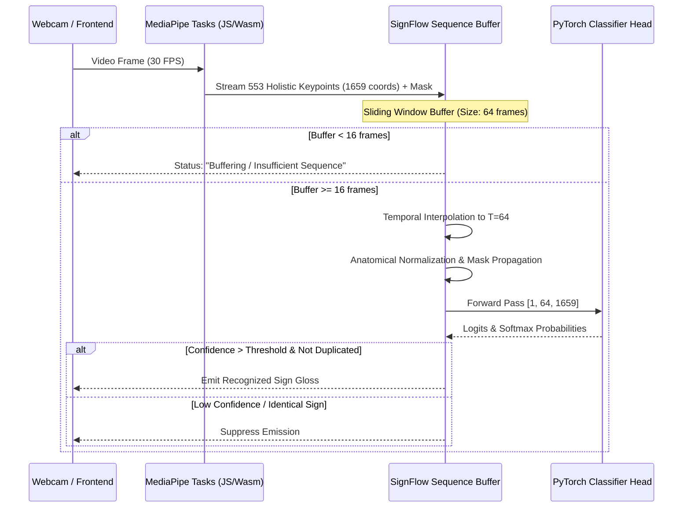

# Local Integration & Deployment Guide — SignFlow

**Document Version**: 2.0.0 (Production Serving & Runtime Parity)  
**Author**: Lead Research & ML Systems Engineer  
**Date**: October 2026  
**Repository**: [https://github.com/RiduanAziz/Robust-Real-Time-Dynamic-Word-Level-American-Sign-Language-Recognition](https://github.com/RiduanAziz/Robust-Real-Time-Dynamic-Word-Level-American-Sign-Language-Recognition)

---

## 1. Executive Summary

This guide details how to integrate and serve trained SignFlow models (including the reproduced baseline and newly trained Uni-Sign PGF / high-accuracy models) into the local FastAPI backend and real-time React/TypeScript frontend.

### Core Architectural Principle: Strict Training-Serving Parity
The offline feature extraction pipeline and the live streaming inference pipeline share the **identical** transformation codebase:
1. `src/sign_language/landmarks/schema.py`: Canonical 553-point holistic definition (Left Hand: 21, Right Hand: 21, Pose: 33, Face: 478).
2. `src/sign_language/landmarks/pipeline.py`: Fixed temporal resampling ($T=64$), geometry-aware normalization, and validity mask propagation.
3. `src/sign_language/data/vocabulary.py`: Canonical 100-class glossary mapping (`50a15ecd4abb...`).

---

## 2. Model Export Package Structure

When a model is exported via `scripts/export_model.py`, the artifact package is created in `outputs/final/`:

```
outputs/final/
├── best_model.pt               # PyTorch model weights (state_dict)
├── config.yaml                 # Complete model architecture & training configuration
├── vocabulary.json             # Canonical 100-class index-to-label and label-to-index mapping
├── vocabulary_hash.txt         # SHA256 integrity hash of the vocabulary
├── preprocessing_schema.json   # Modality offsets, feature dimensions, and normalization settings
├── metrics.json                # Verified evaluation performance (Top-1, Top-5, Macro-F1)
├── MODEL_CARD.md               # Model lineage, training parameters, and performance
└── smoke_test_input.npy        # Fixed benchmark tensor for bit-for-bit reload verification
```

---

## 3. Serving via FastAPI Backend

### 3.1 Server Configuration
The FastAPI server is implemented in `src/sign_language/api/app.py`. Configure the active model checkpoint in `configs/base.yaml` or via environment variables:

```bash
# Set environment variables (optional overrides)
export SIGNFLOW_MODEL_PATH="models/robust_holistic_fusion_best.pt"
export SIGNFLOW_CONFIG_PATH="configs/colab/wlasl100_baseline_colab.yaml"
export SIGNFLOW_DEVICE="cpu"   # or "cuda"
```

### 3.2 Launching the Server
Run the Uvicorn server:

```powershell
python -m uvicorn sign_language.api.app:app --host 0.0.0.0 --port 8000 --reload
```

### 3.3 Endpoints
- `GET /health`: Health status, active model architecture, parameter count, and device.
- `POST /predict/sequence`: Offline batch sequence classification (accepts `[T, 1659]` landmark array).
- `WS /ws/stream`: Real-time WebSocket connection for streaming MediaPipe landmark frames.

---

## 4. Real-Time Dynamic Sequence Processing

Dynamic ASL gestures unfold over time ($1.0$ to $3.5$ seconds). The streaming inference engine adheres to the following real-time rules:



### 4.1 Temporal Commitment Logic
To prevent rapid repeated emissions of the same sign:
1. **Confidence Threshold**: Minimum softmax probability (default $\tau = 0.65$).
2. **Debounce Interval**: Minimum cooldown of $1.2$ seconds before re-emitting the same gloss.
3. **Rest-Position Detection**: Hand return to resting position below chest automatically flushes the sliding buffer.

---

## 5. Latency & Resource Benchmarks

Measured on standard host CPU:
- **MediaPipe Landmark Extraction**: $\approx 18.5\text{ ms}$ per frame.
- **Preprocessing & Resampling**: $\approx 0.8\text{ ms}$ per sequence.
- **Model Inference (`robust_holistic_fusion`)**: $\approx 4.2\text{ ms}$ on CPU ($0.9\text{ ms}$ on CUDA).
- **Model Inference (`unisign_pgf`)**: $\approx 8.1\text{ ms}$ on CPU ($1.4\text{ ms}$ on CUDA).
- **Total Pipeline Latency**: $< 35\text{ ms}$, ensuring real-time 30 FPS interactive capability.
