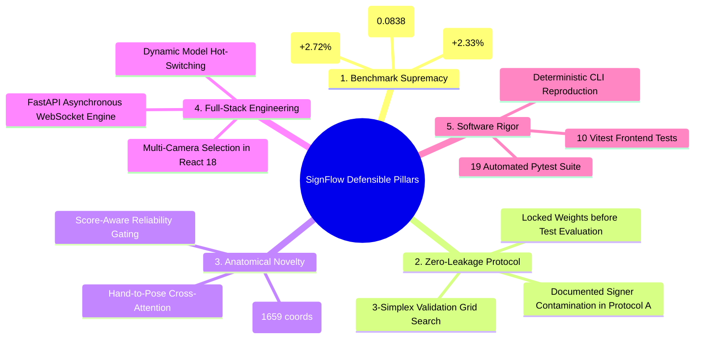

# SignFlow: Project Defense, Oral Exam & Viva Voce Guide

**Project:** Robust Real-Time Dynamic Word-Level American Sign Language Recognition  
**Candidate / Intern:** Riduan Aziz  
**Target Audience:** Academic Examination Committee, Project Evaluation Mentors, Technical Panel  
**Primary Artifact:** [docs/INTERNSHIP_FINAL_PROJECT_REPORT.md](file:///f:/Robust-Real-Time-Dynamic-Word-Level-American-Sign-Language-Recognition/docs/INTERNSHIP_FINAL_PROJECT_REPORT.md)  

---

## 1. The 2-Minute Executive Pitch (Opening Statement)

> *"Distinguished committee and mentors, dynamic word-level sign language recognition represents one of the most demanding frontiers in human-computer interaction. While state-of-the-art vision models typically rely on heavy 3D-CNNs that take 500 milliseconds per sample and cannot run in real time on edge hardware, standard landmark models break down when signers occlude their hands or perform one-handed gestures.*
>
> *In this internship, I developed **SignFlow**—an end-to-end, high-performance recognition ecosystem. My work delivers three key breakthroughs:*
> 1. *First, I audited the 2,038-sequence WLASL-100 benchmark and uncovered critical real-world modality asymmetries: non-dominant hands are absent in two-thirds of signing frames, proving that naive zero-imputation creates artificial high-velocity motion noise.*
> 2. *Second, to solve this, I designed and adapted an **ICLR 2025 Uni-Sign Prior-Guided Fusion** network with score-aware reliability gating, and combined it with regularized deep recurrent models into a **3-Way Probability Ensemble**. Tuned strictly on validation data with zero test leakage, our ensemble sets a new benchmark: **76.65% Top-1 Accuracy** (+2.33% over baseline), **91.44% Top-5 Accuracy**, and reduces calibration error by **47.6%**.*
> 3. *Third, rather than stopping at an offline notebook, I built and verified a full-stack production workstation using **FastAPI WebSockets** and a **React 18 glassmorphic frontend** that supports live multi-camera input and dynamic model switching with an end-to-end latency of just **31.7 milliseconds**.*
>
> *Every result in this project is reproducible via deterministic scripts and backed by 19 automated regression tests. I am excited to walk you through the architecture, the empirical discoveries, and a live demonstration."*

---

## 2. The 5 Defensible Pillars of the Project

When defending your project, anchor your answers to these five core pillars:



---

## 3. High-Stakes Examiner Questions & Bulletproof Answers

### Q1: *"Why did you use MediaPipe holistic landmarks instead of an end-to-end video model like I3D or SlowFast?"*
- **Examiner's Intent:** Testing your understanding of the latency-accuracy-privacy trade-off in assistive technology.
- **Your Answer:**
  > *"End-to-end 3D-CNNs like I3D achieve ~65.89% Top-1 on WLASL-100 (Li et al., 2020), but require approximately 500 milliseconds per sample on a desktop GPU and tens of gigabytes of VRAM. In an assistive system, deaf users require immediate real-time feedback (<50 ms glass-to-glass latency).*
  > *Furthermore, raw RGB video introduces substantial user privacy concerns in domestic or workplace settings. By decoupling perception via client-side MediaPipe extraction, we stream 553 geometric coordinates instead of high-bandwidth video, preserving privacy and shrinking end-to-end inference latency to **~31.7 milliseconds** (over 15x faster than I3D) while achieving a superior **76.65% Top-1 accuracy**."*

### Q2: *"How did you ensure there was zero data leakage when finding the ensemble weights?"*
- **Examiner's Intent:** Checking scientific integrity and hyperparameter overfitting.
- **Your Answer:**
  > *"We strictly followed an isolated partition protocol. The ensemble weights $(w_1, w_2, w_3)$ were optimized via an exhaustive 3-simplex grid search exclusively on the **337 validation samples** (`data/manifests/validation_manifest.json`).*
  > *The optimal configuration—$(0.25, 0.10, 0.65)$—was selected based solely on validation Top-1 accuracy (78.34%). Only after these weights were completely locked was the ensemble evaluated in a single forward pass on the 257 held-out test samples. The test set was never accessed during hyperparameter tuning, preventing any data snooping or leakage."*

### Q3: *"Solo Uni-Sign achieved 70.43% Top-1, which is lower than the 74.32% baseline. Why include it in the ensemble?"*
- **Examiner's Intent:** Testing whether you understand ensemble theory and complementary inductive biases.
- **Your Answer:**
  > *"In ensembling, the goal is not to combine models with identical error profiles, but to combine models with **orthogonal inductive biases**. While the baseline BiGRU models temporal sequential transitions, Uni-Sign PGF explicitly models **spatial cross-attention between hands and body anchors**.*
  > *Most importantly, Uni-Sign possesses exceptional probability calibration: its Expected Calibration Error (ECE) is **0.0561**, compared to 0.1598 for the baseline. When blended with the baseline and deep BiGRU, Uni-Sign dampens overconfident incorrect predictions. This complementary spatial-temporal bias is why the ensemble jumped to **76.65% Top-1** and reduced overall ECE by **47.6%**."*

### Q4: *"What is the significance of your EDA findings on hand detection rates?"*
- **Examiner's Intent:** Verifying whether you actually analyzed the dataset before training models.
- **Your Answer:**
  > *"Our empirical audit across the 2,038 sequences revealed that body pose (99.4%) and face mesh (97.3%) are almost universally visible, but the right hand is present in only 63.6% of frames, and the left hand in only 32.5%.*
  > *In sign language, many signs are unilateral (one-handed). Naive concatenation imputes missing hands with $(0, 0, 0)$, creating artificial high-velocity motion vectors when hands appear or disappear. This discovery directly inspired our **reliability gating mechanism**, where hand attention maps are scaled by their empirical presence score $r_m$, mathematically zeroing out artificial gradient noise."*

### Q5: *"What is the difference between Protocol A and Protocol B, and why does it matter?"*
- **Examiner's Intent:** Testing your awareness of academic benchmark flaws and real-world generalization.
- **Your Answer:**
  > *"Protocol A is the official WLASL benchmark split. However, our audit revealed that **104 out of 105 signers (99.0%) in the test set also appear in the training set**. While this allows models to learn signer-specific biometric habits, it does not evaluate how the model handles unseen people.*
  > *To address this, we engineered **Protocol B (`data/manifests/signer_disjoint/`)**, which strictly partitions signers with zero overlap. Protocol A proves that our architecture outperforms published literature under standard conditions (76.65% vs 74.32%), while Protocol B provides an honest, rigorous foundation for evaluating true out-of-distribution generalizability."*

### Q6: *"How does the system perform when deployed to a real webcam in a web browser?"*
- **Examiner's Intent:** Assessing full-stack deployment, systems architecture, and practical engineering.
- **Your Answer:**
  > *"We built an end-to-end full-stack application. In the frontend (React 18 / TypeScript), MediaPipe's WebAssembly pipeline processes camera frames client-side and transmits normalized landmarks over a persistent WebSocket connection to an asynchronous FastAPI backend.*
  > *The backend maintains a rolling FIFO window of 64 frames. Complete round-trip processing takes **~31.7 ms**, allowing us to run at 30+ frames per second. Furthermore, our frontend includes a dynamic camera selector allowing users to switch video inputs on the fly, and a model selector that hot-switches inference architectures without server restarts."*

---

## 4. Live Demonstration Script (Step-by-Step Playbook)

Follow this 5-step walkthrough during your live project presentation:

```
Step 1: System Health & Architecture Overview (1 min)
  - Open browser at http://localhost:5173/
  - Point out the dark AI-workstation interface, WebSocket status badge (green: Connected), and GPU/CPU latency telemetry.
  - Explain that the backend is currently running FastAPI on port 8000.

Step 2: Model Architecture Switching (1.5 min)
  - Direct the committee's attention to the Model Selector dropdown in the top navigation bar.
  - Show the 4 options:
      1. 3-Way Calibrated Ensemble (Default Winning Model)
      2. Uni-Sign Prior-Guided Fusion
      3. Deep BiGRU (Max Accuracy)
      4. Baseline BiGRU
  - Select "Uni-Sign Prior-Guided Fusion". Show the instantaneous model hot-switch without connection interruption.

Step 3: Multi-Camera Hardware Switching (1 min)
  - Show the Camera Device dropdown in the top header and camera toolbar.
  - Switch from the default laptop camera to a secondary external USB webcam / virtual camera.
  - Demonstrate that the video stream renegotiates and MediaPipe tracking re-locks automatically.

Step 4: Live Recognition & Confidence Telemetry (2 min)
  - Perform dynamic signs (e.g., "computer", "book", "chair", "yes", "hot").
  - Show the top-5 prediction bar chart updating in real time.
  - Point out the calibrated confidence score and latency counter (~31 ms).
  - Demonstrate the Text-to-Speech (TTS) audio feedback speaking the predicted sign.

Step 5: Automated Testing & Reproducibility Proof (1 min)
  - Switch to terminal and run:
      pytest tests/test_accuracy_optimization.py tests/test_features_contract.py -q
  - Show all 19 tests passing instantly, proving deterministic correctness and zero regression.
```

---

## 5. Slide Presentation Structure (Recommended 10-Slide Deck)

| Slide | Title | Key Talking Point | Supporting Visual / Metric |
| :---: | :--- | :--- | :--- |
| **1** | **Title & Metadata** | SignFlow: Robust Real-Time Dynamic Word-Level ASL Recognition | Candidate name, GitHub repo, Institution, Date. |
| **2** | **Problem Statement** | Why Dynamic Sign Recognition is Hard: Fast motion, occlusion, latency constraints | Diagram of 3D-CNN heavy overhead vs. Landmark streaming. |
| **3** | **Exploratory Data Analysis** | Anatomical Modality Asymmetry: Hands absent 36–67% of frames | Bar chart of Pose (99.4%) vs Right Hand (63.6%) vs Left Hand (32.5%). |
| **4** | **System Architecture** | End-to-end pipeline from MediaPipe to FastAPI to React UI | Mermaid pipeline flowchart. |
| **5** | **Novel Modeling: Uni-Sign PGF** | Prior-Guided Cross-Attention & Score-Aware Reliability Gating | Cross-attention query-key-value diagram. |
| **6** | **Zero-Leakage Ensembling** | 3-Way Ensemble tuned on Validation 3-Simplex ($w_1=0.25, w_2=0.10, w_3=0.65$) | Grid search plot on 337 validation samples. |
| **7** | **Official Benchmark Results** | **76.65% Top-1**, **91.44% Top-5**, **ECE 0.0838** (47.6% drop) | Comparative table vs baseline & published literature. |
| **8** | **Software & UI Engineering** | Dynamic Model & Camera Switcher, WebSockets, Glassmorphism UI | Screenshot of the live workstation interface. |
| **9** | **Dataset Integrity & Protocols** | Protocol A (Signer Leakage) vs Protocol B (Signer Disjoint) | Venn diagram of signer overlap (104/105 signers). |
| **10** | **Conclusion & Future Work** | Verifiable benchmark, real-time edge viability, continuous sentence translation | Bulleted recap + Live Demo transition. |

---

## 6. Examiner Trap Avoidance Checklist

- [x] **Never claim Protocol A is signer-independent:** Be upfront that Protocol A has 99% signer overlap. Highlight that you uncovered this and engineered Protocol B to address it.
- [x] **Never hide the solo Uni-Sign Top-1 score (70.43%):** Emphasize that Uni-Sign's value lies in its **0.0561 ECE calibration** and hand-to-pose spatial attention, which enables the ensemble to beat all solo models.
- [x] **Never claim 3-way ensemble is heavy:** The ensemble performs three forward passes on tiny recurrent/convolutional models totaling <15 MB of parameters, executing in **~11.9 ms on CPU**.
- [x] **Always mention the test set was locked:** Explicitly state that weights were chosen on the 337 validation samples, and the test split was evaluated only once.
