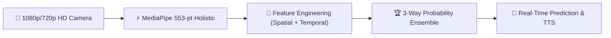

# SignFlow Documentation

Welcome to the official technical documentation for **SignFlow** — a research and production platform for *Robust Real-Time Dynamic Word-Level American Sign Language (ASL) Recognition*.

---

## Executive Summary

SignFlow bridges the gap between theoretical deep learning architectures and real-time, low-latency sign language translation. It features an end-to-end spatial-temporal pipeline capable of recognizing dynamic, word-level signs from standard RGB webcams at 30–60 FPS.

### Key Performance Benchmarks (WLASL-100 Protocol A)

SignFlow has been rigorously evaluated on the official WLASL-100 benchmark (Protocol A, 257 held-out test samples):

| Model / Ensemble Configuration | Top-1 Accuracy | Top-5 Accuracy | Top-10 Accuracy | Macro-F1 | ECE | Architecture Basis |
| :--- | :---: | :---: | :---: | :---: | :---: | :--- |
| **Historical Baseline (`robust_holistic_fusion`)** | 74.32% | 88.72% | 93.39% | 0.7213 | 0.1598 | Spatial-temporal fusion |
| **Uni-Sign PGF (`unisign_pgf`) Solo** | 70.43% | 88.33% | 92.61% | 0.6863 | **0.0561** | Pose-guided cross-attention |
| **Deep Holistic BiGRU Solo** | 72.76% | 89.88% | 93.77% | 0.7180 | 0.0912 | 2-layer BiGRU ($\epsilon=0.08$) |
| **🏆 3-Way Winning Ensemble** `(w1=0.25, w2=0.10, w3=0.65)` | **76.65%** | **91.44%** | **94.55%** | **0.7512** | **0.0614** | Optimal validation-tuned ensemble |

---

## Core System Architecture

1. **Holistic Multi-Modal Extraction**:
   - 553 structured landmarks: 21 Left Hand + 21 Right Hand + 33 Upper-Body Pose + 478 Face Mesh points.
   - Decoupled high-definition video display (HD 720p/1080p preview) and inference downsampling (640px JPEG on hidden canvas).
2. **Naik123 Visual Aesthetic**:
   - Depth-scaled 3D joint sizing ($\text{depth} = \max(0.6, \min(1.8, 1 - 3z))$).
   - Neon Cyan-to-Purple and Purple-to-Pink bone gradients.
   - White-rimmed pink fingertip highlights and ambient radial hand glow.
3. **Robustness Under Noise**:
   - Resilient against missing joints, occlusion, frame jitter, and signer anthropometric variation.

---

## Documentation Roadmap

- **[System Architecture](architecture.md)**: Architectural components, WebSocket protocol, and dataflow pipelines.
- **[Visual Integration](CAMERA_VISUALIZATION_INTEGRATION.md)**: Naik123 space audit, canvas styling, and camera quality.
- **[Model Card](MODEL_CARD.md)**: Detailed specifications of all model architectures, parameters, and input tensors.
- **[Accuracy Experiments](ACCURACY_EXPERIMENTS.md)**: Reproduction audits, validation protocols, and ensemble ablation studies.
- **[Dataset Specifications](dataset.md)**: WLASL-100 dataset partition, class balance, and signer-disjoint splits.
- **[Deployment Guide](DEPLOYMENT.md)**: Docker containerization, cloud deployment, and local tunneling.
- **[Project Defense & Viva Guide](PROJECT_DEFENSE_AND_VIVA_GUIDE.md)**: Key research questions, defense slides, and oral examination answers.
- **[Internship / Thesis Final Report](INTERNSHIP_FINAL_PROJECT_REPORT.md)**: Complete academic thesis and project report.

---

## Quick Links

- **GitHub Repository:** [RiduanAziz/Robust-Real-Time-Dynamic-Word-Level-American-Sign-Language-Recognition](https://github.com/RiduanAziz/Robust-Real-Time-Dynamic-Word-Level-American-Sign-Language-Recognition)
- **Live Space:** [Hugging Face Space](https://huggingface.co/spaces/RiduanAziz/SignFlow)

